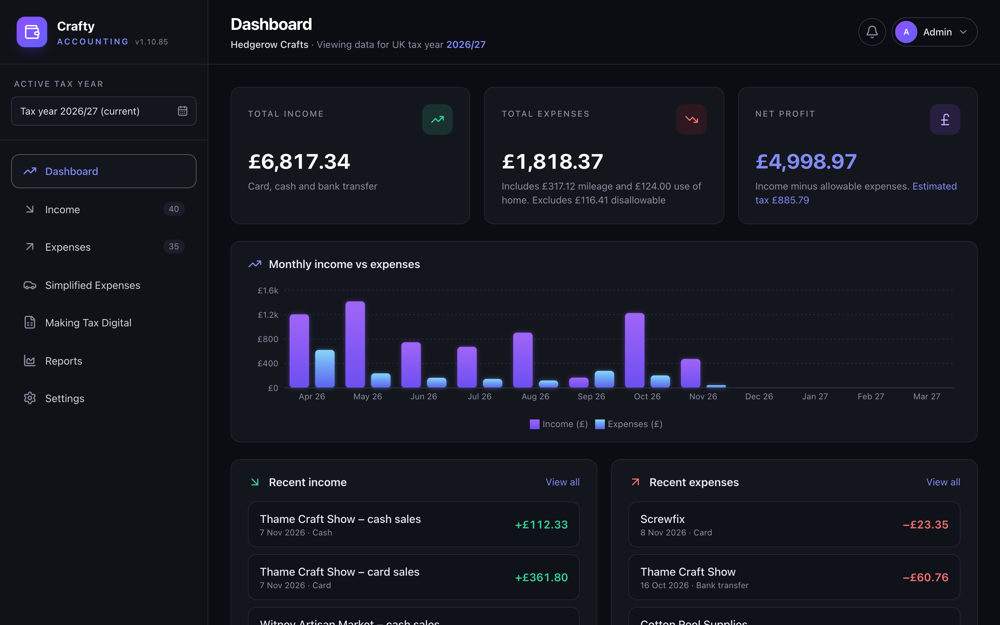

# Crafty Accounting

Self-hosted bookkeeping for UK sole traders on the cash basis. Keep your income and expenses on your own server, then file with HMRC on a Self Assessment return or through Making Tax Digital.



## What it does

- Income and expenses with categories, line items and attached receipts
- Mileage and use of home at HMRC's simplified rates
- SA103S box figures, quarterly Making Tax Digital figures and a tax estimate
- Reports, year-on-year comparison, CSV and JSON export and import
- Optional AI reading of invoices (Claude or Gemini) and imports from Square
- Several users, editor or read-only, with changes shown live
- Daily automatic backups and one-click updates

## Install

There are two ways to install. Both serve the app over HTTPS through [Caddy](https://caddyserver.com), install the latest release and print the address to open.

### Linux server (recommended)

For a Linux server or container with systemd, such as Debian or Ubuntu in a Proxmox LXC. Run as **root**:

```bash
bash -c "$(curl -fsSL https://raw.githubusercontent.com/koder-guy/crafty-accounting/main/install.sh)"
```

It creates a `crafty` account, installs the app with its own Node and Caddy in `/home/crafty/crafty-accounting`, and sets up two services that start on boot. Updates install from inside the app.

### Docker (Mac or any Linux)

Needs Docker (on a Mac, Docker Desktop or OrbStack; on Linux the script offers to install it):

```bash
/bin/bash -c "$(curl -fsSL https://raw.githubusercontent.com/koder-guy/crafty-accounting/main/install-docker.sh)"
```

It sets everything up in `~/crafty-accounting` and starts the containers. To update, run `~/crafty-accounting/install-docker.sh` again.

Both installers ask which address you'll browse to (if the server has more than one) and for an optional domain name. Ports 80 and 443 are used unless you set `CRAFTY_HTTP_PORT` and `CRAFTY_HTTPS_PORT` before the command.

**First sign-in:** username `Admin`, password `admin`. You'll be asked to choose your own password straight away.

### HTTPS

Out of the box Caddy uses its own private certificate authority, so each device needs to trust it once. Download it from `https://<server address>/crafty-root.crt` (the installers also save it as `crafty-root.crt` and print its fingerprint and a Mac command that trusts it), then:

- **Mac:** add it to the System keychain and set it to **Always Trust**.
- **Windows:** **Install Certificate → Local Machine → Trusted Root Certification Authorities**.
- **iPhone/iPad:** install the profile, then turn it on in **Settings → General → About → Certificate Trust Settings**.
- **Android:** **Settings → Security → Encryption & credentials → Install a certificate → CA certificate**.

Alternatively, the app can use a Let's Encrypt certificate for a domain on Cloudflare, or a certificate you upload, which browsers already trust.

## Configuration

The installers write a `.env` file in the install's folder; every setting has a default. After changing it, run `/home/crafty/crafty-accounting/crafty restart` (Linux) or `docker compose up -d` (Docker).

| Variable | Default | Purpose |
|---|---|---|
| `SITE_ADDRESS` | `localhost` | Addresses you browse to, comma separated. The server's own network IP is always included. |
| `SITE_IP` | `localhost` | The IP address in `SITE_ADDRESS` browsers use |
| `HTTP_PORT` / `HTTPS_PORT` | `80` / `443` | Ports Caddy listens on |
| `ADMIN_NAME` / `ADMIN_PASSWORD` | `Admin` / `admin` | The first user, created only when nobody exists yet |
| `DATA_DIR` | `./data` (`/data` in Docker) | Database and documents |
| `BACKUP_DIR` | `DATA_DIR/backups` | Linux install: where daily backups go |
| `BACKUP_HOST_DIR` | `./backups` | Docker: the folder on the host for daily backups |
| `MAX_UPLOAD_MB` | `20` | Largest document you can attach |
| `TZ` | `Europe/London` | Time zone for the daily backup |
| `UPDATE_CHECK` | `true` | `false` stops the automatic check for new versions |
| `TLS_CUSTOM` | on | `off` ignores an uploaded certificate (if browsers refuse it) |
| `ACME_CA` | Let's Encrypt | Another ACME authority for a Cloudflare domain, such as Let's Encrypt staging |
| `SESSION_SECRET` | generated | Signs the session cookie |

Backups belong on another disk or a NAS. The app's account must be able to write to the backup folder; with Docker on Linux, `sudo chown 1000:1000 <folder>`.

## Uninstall

This deletes the books, documents, backups and settings, so download a backup first.

- **Linux:** as root, run the uninstaller. It lists what it will remove and asks you to type `delete`.

  ```bash
  bash -c "$(curl -fsSL https://raw.githubusercontent.com/koder-guy/crafty-accounting/main/uninstall.sh)"
  ```

- **Docker:**

  ```bash
  cd ~/crafty-accounting && docker compose down --volumes --rmi local && cd .. && rm -rf crafty-accounting
  ```

Then remove "Caddy Local Authority" from each device that trusted it.

## Development

Needs Node 22+.

```bash
npm install
npm run dev
```

The client runs at <http://localhost:5173> and the API on port 3000. `npm test` runs the tests, `npm run typecheck` checks types and `npm run seed` loads sample data.

## Licence

MIT; see [LICENSE](LICENSE). Crafty Accounting comes with no warranty: it helps you keep your books, but you remain responsible for what you submit to HMRC.
